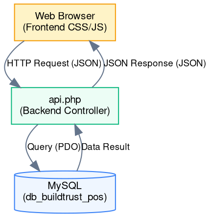

# Arsitektur & Desain Sistem - BuildTrust POS

Dokumen ini menjelaskan rancangan arsitektur perangkat lunak, struktur direktori, serta detail desain database (skema tabel dan relasi) pada aplikasi **BuildTrust POS**.

---

## 1. Tinjauan Arsitektur Sistem

Aplikasi ini menggunakan pola arsitektur **Client-Server Monolitik Sederhana** dengan teknologi **PHP Native** di sisi backend dan **HTML/CSS/JavaScript (Vanilla)** di sisi frontend.



*   **Frontend (UI & Logic):** Menggunakan HTML5 semantik untuk antarmuka, CSS kustom untuk layout responsif, dan JavaScript (Vanilla ES6) untuk menangani dinamika interaksi (cart, modal nota, render tabel jurnal/buku besar) serta melakukan request data menggunakan API `fetch()`.
*   **Backend (Controller / API Router):** Seluruh request operasional diarahkan ke berkas tunggal [api.php](file:///c:/Users/youth/Downloads/buildtrust-pos/api.php) yang berfungsi sebagai pengendali/router API. Aksi ditentukan melalui parameter URL `?action=name` atau data POST.
*   **Database (Persistence):** Menggunakan MySQL dengan driver PHP **PDO** (PHP Data Objects) untuk interaksi data yang aman dari SQL Injection melalui prepared statements.

---

## 2. Struktur Database (Schema)

Database yang digunakan bernama **`db_buildtrust_pos`** yang terdiri dari 6 tabel utama:

### A. Tabel `users`
Menyimpan data akun pengguna sistem untuk proses autentikasi dan otorisasi.
*   `id` (INT, Auto Increment, Primary Key)
*   `username` (VARCHAR(50), Unique, Not Null): Nama pengguna untuk login.
*   `password` (VARCHAR(255), Not Null): Hash password bcrypt.
*   `nama` (VARCHAR(100), Not Null): Nama lengkap pengguna.
*   `role` (ENUM('admin', 'kasir', 'owner'), Not Null): Peran pengguna di dalam sistem.
*   `created_at` (TIMESTAMP, Default CURRENT_TIMESTAMP)

### B. Tabel `products`
Menyimpan daftar material bangunan beserta data stok dan limit minimum stok.
*   `id` (INT, Auto Increment, Primary Key)
*   `nama` (VARCHAR(150), Not Null): Nama material (misal: "Semen Tiga Roda 40kg").
*   `merk` (VARCHAR(100), Not Null): Merk barang.
*   `kategori` (VARCHAR(50), Not Null): Kategori material (Semen, Besi, Pipa, dll).
*   `harga` (INT, Not Null): Harga jual per satuan.
*   `satuan` (VARCHAR(20), Not Null): Unit satuan terkecil (Sak, Batang, Pail, Lembar).
*   `stok` (INT, Not Null): Jumlah stok fisik yang tersedia.
*   `min_stok` (INT, Not Null): Ambang batas stok minimum untuk memicu peringatan.
*   `konversi` (VARCHAR(100), Null): Informasi deskriptif konversi satuan (misal: "1 Sak = 40 Kg").
*   `created_at` (TIMESTAMP, Default CURRENT_TIMESTAMP)
*   `updated_at` (TIMESTAMP, Default CURRENT_TIMESTAMP ON UPDATE CURRENT_TIMESTAMP)

### C. Tabel `transactions`
Menyimpan ringkasan transaksi penjualan (nota utama).
*   `id` (INT, Auto Increment, Primary Key)
*   `nota_no` (VARCHAR(50), Unique, Not Null): Nomor nota acak unik (misal: "TX-628192").
*   `pelanggan` (VARCHAR(100), Not Null): Nama pelanggan (default: "Pelanggan Umum").
*   `metode_pembayaran` (VARCHAR(50), Not Null): "Tunai" atau "Nontunai".
*   `subtotal` (INT, Not Null): Total harga sebelum pajak.
*   `tax` (INT, Not Null): Nilai PPN (11% dari subtotal).
*   `total` (INT, Not Null): Total akhir yang harus dibayar (`subtotal` + `tax`).
*   `bayar` (INT, Not Null): Nominal uang yang diserahkan pelanggan.
*   `kembalian` (INT, Not Null): Uang kembalian transaksi tunai.
*   `created_at` (TIMESTAMP, Default CURRENT_TIMESTAMP)

### D. Tabel `transaction_items`
Menyimpan rincian item barang yang dibeli pada setiap transaksi.
*   `id` (INT, Auto Increment, Primary Key)
*   `transaction_id` (INT, Not Null): Relasi ke tabel `transactions`.
*   `product_id` (INT, Not Null): Relasi ke tabel `products`.
*   `qty` (INT, Not Null): Jumlah barang yang dibeli.
*   `harga` (INT, Not Null): Harga satuan produk pada saat transaksi terjadi.
*   `satuan` (VARCHAR(20), Not Null): Satuan produk saat dibeli.
*   *Foreign Key:* `transaction_id` merujuk ke `transactions(id)` dengan opsi `ON DELETE CASCADE`.

### E. Tabel `jurnal`
Menyimpan catatan pembukuan double-entry akuntansi untuk setiap aktivitas keuangan.
*   `id` (INT, Auto Increment, Primary Key)
*   `jurnal_no` (VARCHAR(50), Not Null): Nomor referensi jurnal akuntansi (misal: "JRN-2918").
*   `transaction_id` (INT, Null): Relasi opsional ke tabel `transactions`.
*   `tanggal` (DATE, Not Null): Tanggal penjurnalan.
*   `ref` (VARCHAR(10), Not Null): Kode referensi akun (misal: '111' untuk Kas Toko, '411' untuk Pendapatan Penjualan).
*   `akun` (VARCHAR(100), Not Null): Nama akun akuntansi.
*   `d` (INT, Not Null, Default 0): Nilai debit (Debet).
*   `k` (INT, Not Null, Default 0): Nilai kredit (Kredit).
*   `desc` (TEXT, Not Null): Deskripsi transaksi jurnal.
*   `created_at` (TIMESTAMP, Default CURRENT_TIMESTAMP)
*   *Foreign Key:* `transaction_id` merujuk ke `transactions(id)` dengan opsi `ON DELETE SET NULL`.

### F. Tabel `activity_logs`
Menyimpan rekaman catatan aktivitas sistem (audit trail) untuk keamanan.
*   `id` (INT, Auto Increment, Primary Key)
*   `waktu` (TIMESTAMP, Default CURRENT_TIMESTAMP)
*   `user` (VARCHAR(100), Not Null): Nama user yang melakukan aksi (atau "System Guard" / "System Monitor").
*   `aksi` (TEXT, Not Null): Deskripsi aktivitas.
*   `tipe` (VARCHAR(20), Not Null): Tingkatan log (`info`, `sukses`, `warning`).

---

## 3. Hubungan Relasional Antar Tabel (Entity Relationships)

Berikut adalah keterkaitan relasional database pada sistem BuildTrust POS:

1.  **Satu transaksi memiliki banyak item transaksi:** `transactions.id` terhubung ke `transaction_items.transaction_id` (1-to-Many). Jika transaksi dihapus, semua item rinciannya otomatis terhapus (`ON DELETE CASCADE`).
2.  **Item transaksi mereferensikan produk:** `transaction_items.product_id` mereferensikan `products.id` untuk melacak produk yang dibeli.
3.  **Satu transaksi menghasilkan beberapa entri jurnal akuntansi:** `transactions.id` terhubung ke `jurnal.transaction_id` (1-to-Many). Apabila suatu data transaksi dihapus/dibersihkan, entri jurnal tetap dipertahankan dengan nilai `transaction_id = NULL` (`ON DELETE SET NULL`) agar sejarah pembukuan umum akuntansi tidak rusak secara struktural.

---

## 4. Struktur Direktori Proyek

Struktur folder aktual dari aplikasi BuildTrust POS adalah sebagai berikut:

```text
buildtrust-pos/
│
├── API/                          # Folder API Tambahan (Legacy / Cadangan)
│   ├── get_product.php           # Mendapatkan data material tunggal
│   └── save_transaction.php      # Menyimpan transaksi kasir
│
├── config/                       # Folder Konfigurasi Database Lama
│   └── db.php                    # Koneksi database menggunakan mysqli
│
├── dokumentasi/                  # [NEW] Folder Dokumentasi Proyek
│   ├── srs.md                    # Spesifikasi Kebutuhan Perangkat Lunak
│   ├── arsitektur_dan_desain.md  # Arsitektur & Desain Database (Berkas ini)
│   ├── api_endpoints.md          # Dokumentasi API Endpoint
│   └── panduan_pengguna.md       # Panduan Instalasi & Penggunaan
│
├── api.php                       # Backend API Router Utama (Menggunakan PDO)
├── dashboard.php                 # Tampilan Utama Aplikasi (Dinonaktifkan in-memory, aktif PHP/MySQL)
├── dashboard_inmemory.php        # Versi Cadangan Aplikasi berbasis In-Memory (JS Only)
├── database.sql                  # Skema database & data seeding awal
├── db.php                        # Koneksi database utama menggunakan PDO
└── README.md                     # Petunjuk singkat menjalankan proyek
```

> [!NOTE]
> File [db.php](file:///c:/Users/youth/Downloads/buildtrust-pos/db.php) pada root direktori adalah file konfigurasi database utama yang menggunakan **PDO** dan dipakai oleh [api.php](file:///c:/Users/youth/Downloads/buildtrust-pos/api.php). Sedangkan folder `config/` dan `API/` berisi script lama/cadangan.
