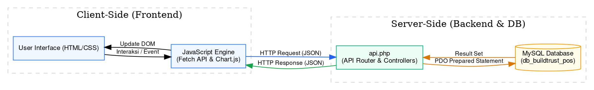
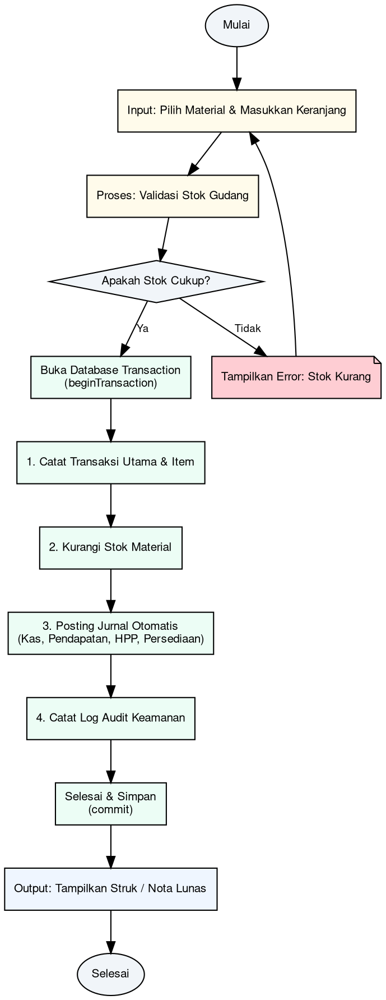
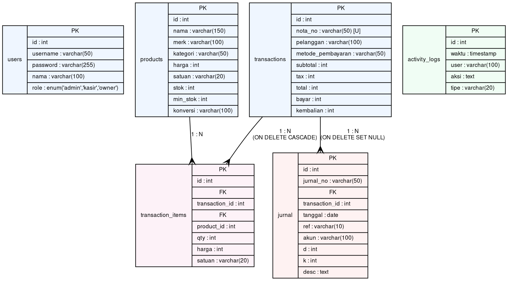

# BAB 3: PERANCANGAN SISTEM

## 3.1 Arsitektur Sistem
Aplikasi **BuildTrust-POS** menerapkan arsitektur Client-Server Monolitik 2-Tier. Frontend (Client-side) berinteraksi dengan API Backend (Server-side) secara asinkron menggunakan protokol HTTP dengan payload data terformat JSON.



---

## 3.2 Workflow Sistem
Workflow sistem mendeskripsikan siklus pemrosesan data, dari input transaksi hingga penulisan jurnal keuangan otomatis dan log aktivitas.



### Narasi Alur Kerja Transaksi Kasir:
1.  **Input:** Kasir memilih material bangunan dari katalog dan memasukkan jumlah barang.
2.  **Validasi:** Sistem mencocokkan jumlah pesanan dengan stok material aktual di database menggunakan query ber-kunci eksklusif (`FOR UPDATE`). Jika stok tidak mencukupi, transaksi dibatalkan dengan pesan peringatan.
3.  **Proses Transaksi Aman:** Jika stok cukup, transaksi database dimulai. Sistem melakukan penulisan berurutan: menyimpan nota di tabel `transactions` & `transaction_items`, mengurangi stok barang di tabel `products`, memposting entri akuntansi double-entry di tabel `jurnal`, dan menulis status log sukses di tabel `activity_logs`.
4.  **Commit & Output:** Semua perubahan disimpan secara permanen (`commit`). Jika di tengah jalan terdapat salah satu langkah penulisan yang gagal, seluruh rangkaian transaksi dibatalkan (`rollBack`). Setelah berhasil, popup nota lunas dirender untuk kasir.

---

## 3.3 Class Diagram
Meskipun aplikasi ini menggunakan PHP Native dengan pendekatan fungsional/prosedural pada `api.php`, berikut adalah **Class Diagram Konseptual** yang menggambarkan representasi modul-modul logika berorientasi objek dalam perancangan sistem:

```graphviz
classdiagram
digraph ClassDiagram {
    node [shape=record, style=filled, fillcolor="#f8fafc", fontname="Courier New,Courier,monospace", fontsize=9];
    edge [arrowhead=vee, fontname="Helvetica,Arial,sans-serif", fontsize=9];

    DatabaseConnection [label="{DatabaseConnection|- host: string\l- db: string\l- user: string\l- pass: string\l- pdo: PDO\l|+ connect(): PDO\l+ disconnect(): void\l}"];
    
    AuthController [label="{AuthController||+ login(username, password): bool\l+ logout(): bool\l+ getUserSession(): User\l}"];
    
    ProductController [label="{ProductController||+ getProducts(): Array\l+ addProduct(data): bool\l+ updateStock(productId, qty): bool\l}"];
    
    TransactionController [label="{TransactionController||+ checkout(pelanggan, metode, cart, bayar): Array\l- saveTransaction(): int\l- saveItems(txId, items): void\l}"];
    
    JournalController [label="{JournalController||+ getJournals(): Array\l+ postJournalEntry(txId, ref, akun, d, k, desc): bool\l+ resetJournal(): bool\l}"];
    
    AuditLogger [label="{AuditLogger||+ getLogs(): Array\l+ logActivity(user, action, type): bool\l+ clearLogs(): bool\l}"];

    // Relationships
    AuthController -> DatabaseConnection [label="uses"];
    ProductController -> DatabaseConnection [label="uses"];
    TransactionController -> DatabaseConnection [label="uses"];
    JournalController -> DatabaseConnection [label="uses"];
    AuditLogger -> DatabaseConnection [label="uses"];
    
    TransactionController -> ProductController [label="updates stock"];
    TransactionController -> JournalController [label="posts journals"];
    TransactionController -> AuditLogger [label="logs security"];
}
```

---

## 3.4 Entity Relationship Diagram (ERD)
Perancangan struktur basis data BuildTrust-POS dirancang relasional untuk menjamin konsistensi data penjualan dan data keuangan.


